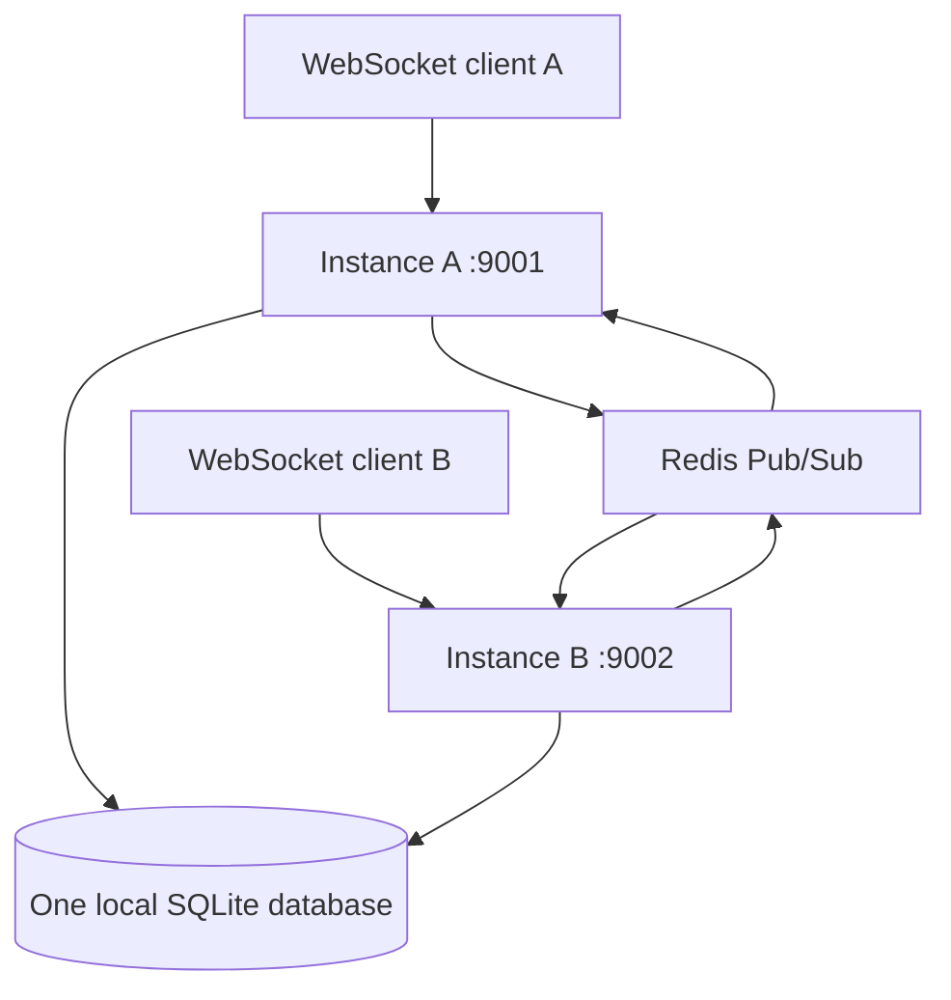

# Architecture and boundaries

Each instance has one uWebSockets loop, a connection table, one SQLite worker with a bounded queue, and separate Redis publisher and subscriber threads. The repository owns its SQLite connection on the database thread. Workers deliver results to the owning loop using `Loop::defer`; deferred replies look up the current connection by an internal ID. Each process publishes only to its own socket subscriptions. The subscriber suppresses its own instance ID, so the local broadcast is not repeated by the Redis echo.

New messages commit to SQLite before local broadcast and Redis publication. Unique `(sender_id, client_msg_id)` prevents duplicate rows and identical retries do not rebroadcast. A database commit and Redis publish are not atomic: failure can lose live delivery, while history remains queryable. User room offsets are prefix cursors, not per-message delivery receipts. Redis Pub/Sub is not durable. SQLite WAL still permits only one writer at a time; the design is a single-host demonstration and is not multi-host high availability. The actual tests and limitations are described in [phase2.md](phase2.md) and [performance.md](performance.md).

Project-authored components are the protocol and room flow in `src/main.cpp`, `StorageWorker`, `MessageRepository`, `RedisBridge`, tests and scripts. WebSocket/network/event-loop internals come from uWebSockets/uSockets; SQLite and Redis connectivity use SQLiteCpp and Hiredis. No original epoll implementation is claimed.
