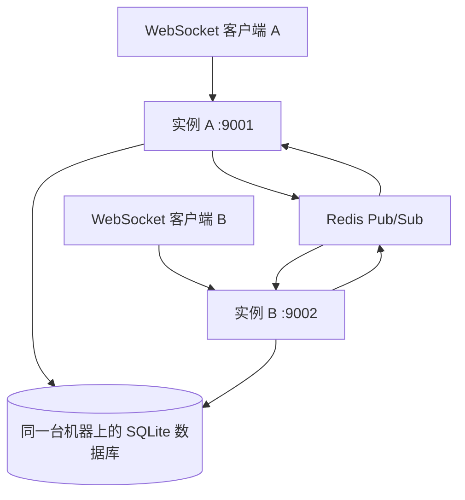

# 系统架构与边界

每个实例包含一个 uWebSockets 事件循环、连接表、带有界队列的 SQLite 工作线程，以及独立的 Redis 发布和订阅线程。数据库连接由其工作线程持有。消息分发依赖 `MessageStore` 接口，目前只实现并测试了 SQLite。后台线程使用 `Loop::defer` 将结果交回事件循环；异步回复通过连接编号查找当前连接，避免使用已释放的连接。

两个实例各自向本进程内的订阅连接推送。Redis 事件包含实例 ID，订阅端忽略本实例发出的事件，避免本地广播后再次处理自己的转发事件。数据库保存房间成员，广播按成员投递。

新消息先提交 SQLite，再进行本地广播和 Redis 发布。`(sender_id, client_msg_id)` 唯一约束防止重复写入；相同请求重试不会重新广播。SQLite 提交与 Redis 发布不是原子操作，失败时可能丢失实时投递，但可以查询历史记录。服务逐条记录 ACK，只在连续消息已确认时推进游标。Redis Pub/Sub 不保存离线消息；SQLite WAL 下同时仍只有一个写事务。本项目是单机演示，不是多机高可用系统。[协议](phase2.md)和[性能记录](performance.md)说明了测试范围及限制。

项目编写的部分包括 `src/main.cpp` 中的协议和房间流程、`ConnectionManager`、`MessageDispatcher`、`StorageWorker`、`MessageRepository`、`RedisBridge` 及测试和脚本。`ConnectionManager` 管理事件循环内的连接编号，`MessageDispatcher` 在数据库工作线程执行请求并返回响应和广播事件。WebSocket、网络及事件循环底层来自 uWebSockets/uSockets；数据库和 Redis 连接使用 SQLiteCpp、Hiredis，并非自研 epoll 网络栈。
